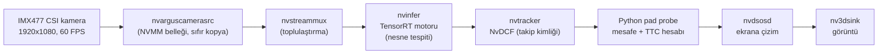
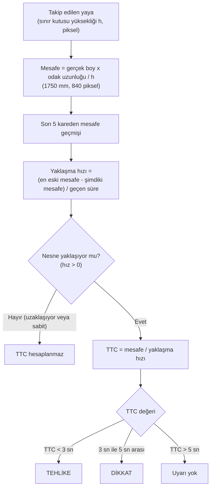
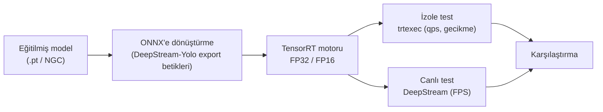

# Kenar Bilişim Üzerinde Gerçek Zamanlı İleri Çarpışma Uyarı Sistemi (FCW)

NVIDIA Jetson Orin Nano üzerinde, CSI kameradan gelen görüntüde yayaları tespit eden, her yayanın mesafesini ve çarpışmaya kalan süreyi (TTC) hesaplayıp **DİKKAT / TEHLİKE** uyarısı üreten uçtan uca bir sistem.

Kütahya Sağlık Bilimleri Üniversitesi, Bilgisayar Mühendisliği Lisans Bitirme Projesi (2026).

## Proje ne yapıyor?

Kamera önündeki yayayı bulur, ona bir kimlik verip takip eder, ne kadar uzakta olduğunu ve ne hızla yaklaştığını tahmin eder. Yaklaşma hızına göre çarpışmaya kaç saniye kaldığını hesaplar ve ekrana uyarı basar. Tüm işlem kenar cihazda, buluta görüntü göndermeden çalışır.

Projenin ikinci amacı, aynı sistemin içinde dokuz farklı nesne tespit modelini (PeopleNet, YOLOv8n/s/m, YOLOv9c, YOLOv10n, YOLO11n, YOLO26m, RT-DETR-l) FP32 ve FP16 hassasiyetinde karşılaştırmaktır.

## Sistem akışı

Görüntü, kameradan ekrana kadar GPU belleğinde kalır. Python tarafı yalnızca nesne meta verisini (kutu, güven skoru, takip kimliği) okur, görüntüyü kopyalamaz.

## Mesafe ve TTC nasıl hesaplanıyor?

Mesafe, tek kamera ve sabit ortalama insan boyu varsayımıyla bulunan bir **mühendislik tahminidir**, kesin ölçüm değildir.

## Model hazırlama süreci

## Sonuçlardan örnekler

Jetson Orin Nano 8GB, DeepStream 7.1, CUDA 12.6.

**Canlı pipeline (FP32), kamera 60 FPS ile sınırlı:**

| Model | FPS |
|---|---|
| YOLO11n / YOLOv8n / YOLOv10n | ~59,7 - 59,9 (kamera sınırı) |
| YOLOv8s | 44,7 |
| PeopleNet | 28,9 |
| YOLOv8m | 24,7 |
| YOLOv9c | 20,0 |
| RT-DETR-l | 15,0 |

**İzole motor testi (trtexec), FP32 ve FP16 throughput:**

| Model | FP32 (qps) | FP16 (qps) | Kazanç |
|---|---|---|---|
| YOLOv10n | 94,9 | 208,9 | +%120 |
| YOLOv8s | 55,6 | 142,7 | +%157 |
| PeopleNet | 35,1 | 83,9 | +%139 |
| YOLOv8m | 29,8 | 68,4 | +%130 |
| YOLOv9c | 18,9 | 44,8 | +%138 |
| RT-DETR-l | 19,1 | 35,9 | +%88 |
| YOLO26m | 30,6 | 56,3 | +%84 |

Küçük modeller canlı pipeline'da kameranın 60 FPS sınırına takıldığı için FP16 kazancı yalnızca izole testte görülür. Yaya tespitine özel eğitilmiş PeopleNet modeli FP16 ile 47,8 FPS verdi ve test senaryosunda takip kimliğini en kararlı tutan seçeneklerden biri oldu.

## Karşılaşılan başlıca mühendislik sorunları

- Standart Ultralytics ONNX çıktısı, DeepStream-Yolo ayrıştırıcısıyla uyumsuz çıktı. Kütüphanenin kendi `export_*.py` betikleri kullanıldı.
- RT-DETR-l, farklı çıkış formatı nedeniyle tüm nesneleri "bisiklet" olarak etiketledi. `patches/nvdsparsebbox_Yolo.cpp` içinde özel bir ayrıştırıcı (`NvDsInferParseRTDETR`) yazılarak çözüldü.
- Sınır kutusu titreşimi mesafede dalgalanma yaratır. Bu yüzden yaklaşma hızı tek kareden değil, her yaya için son 5 karelik pencereden hesaplanır.

## Dosyaların açıklaması

**src/**

| Dosya | Ne yapar |
|---|---|
| `capture.py` | Geliştirmenin ilk adımı. CSI kameradan GStreamer ile kare alıp NumPy dizisine çevirir ve FPS ölçer. Model yoktur, yalnızca görüntü yakalama katmanını doğrular. |
| `test_probe.py` | Pad probe'un ilk testi. Tracker çıkışındaki tüm nesnelerin sınıf, takip kimliği, güven skoru ve kutu koordinatlarını konsola yazar. 300 kare sonra durur. |
| `deepstream_ttc_deneme1.py` | İlk mesafe ve TTC sürümü. Sonuçları yalnızca konsola yazar, ekrana çizmez. |
| `deepstream_ttc.py` | **Ana uygulama.** Yalnızca insan sınıfını izler; mesafe ve TTC'yi hesaplar, DİKKAT/TEHLİKE uyarısını konsola yazar ve ID, mesafe, TTC bilgisini ekrandaki kutu etiketine basar. |
| `deepstream_benchmark.py` | `deepstream_ttc_deneme1.py` ile aynı içeriktedir. FPS ölçümleri bu betikle değil, `deepstream-app` ve `trtexec` ile yapılmıştır. |

**configs/**

| Dosya | Ne yapar |
|---|---|
| `config_infer_primary*.txt`, `config_infer_yolov8.txt` | nvinfer (model) yapılandırmaları |
| `source1_csi_*.txt` | `deepstream-app` için CSI kamera kaynağı ve pipeline yapılandırmaları (YOLOv8, YOLOv8n ve PeopleNet) |
| `config_tracker_NvDCF_perf.yml` | NvDCF takip algoritması ayarları (performans profili) |
| `labels.txt` | Sınıf etiketleri |

**patches/**
- `nvdsparsebbox_Yolo.cpp`: DeepStream-Yolo'nun ayrıştırıcısı. RT-DETR-l çıkış formatını okuyan `NvDsInferParseRTDETR` fonksiyonu eklenmiştir.

## Çalıştırma notları

Betikler geliştirme cihazındaki yollarla yazılmıştır ve kendi ortamına göre düzenlenmelidir:
- `sys.path.append('/home/hasan/deepstream_python_apps/apps')`: `common.bus_call` modülü için `deepstream_python_apps` deposunun yolu
- `config-file-path`: nvinfer yapılandırma dosyası (`deepstream_ttc.py` içinde `config_infer_primary_yolov8m_fp16.txt`, bu dosya depoda yoktur, `configs/` içindeki yapılandırmalardan birini gösterecek şekilde değiştirilmelidir)
- Tracker yapılandırması DeepStream'in `samples/configs/deepstream-app/` klasöründen okunur

Gereksinimler: Jetson Orin Nano, JetPack, DeepStream 7.1, pyds (Python bindings), CSI kamera.

## Kullanılan açık kaynak projeler

- [DeepStream-Yolo](https://github.com/marcoslucianops/DeepStream-Yolo): YOLO ve RT-DETR modellerinin DeepStream'e aktarılması
- [deepstream_python_apps](https://github.com/NVIDIA-AI-IOT/deepstream_python_apps): Python (pyds) arayüzü
- [Ultralytics](https://docs.ultralytics.com/): YOLO modelleri
- [NVIDIA NGC PeopleNet](https://catalog.ngc.nvidia.com/): yaya tespitine özel model
- [NVIDIA DeepStream SDK](https://developer.nvidia.com/deepstream-sdk), TensorRT, CUDA

## Sınırlılıklar

- Kontrollü iç mekân ortamında, tek yayalı senaryoyla test edildi.
- Yalnızca insan sınıfı için uyarı üretir.
- Mesafe tahmini tek kameraya ve sabit boy varsayımına dayanır.
- INT8 kuantizasyonu kapsam dışı bırakıldı.

## Yazar

Hasan Ögüt, Danışman: Dr. Öğr. Üyesi Ahmet Baştuğ

Proje raporu talep üzerine paylaşılabilir.
